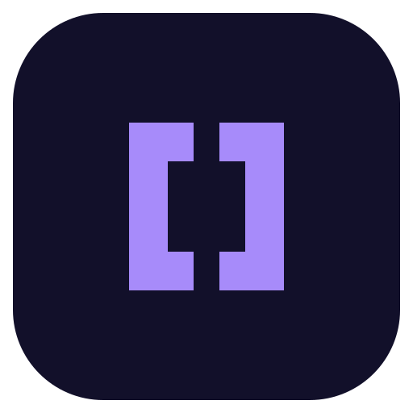

<p align="center">
  
</p>
<h1 align="center">oc-harness-setup</h1>
<p align="center"><strong>Install and orchestrate the whole OpenCode harness in one command - PowerShell.</strong></p>
<p align="center">
  <a href="LICENSE"></a>
  
  
  <a href="https://github.com/nathwn12/oc-harness-setup/actions/workflows/ci.yml"></a>
</p>

## What it is

oc-harness-setup is a plug-and-play installer for the whole OpenCode harness. One explicit command lands an orchestrator primary with 7 agents, 14 commands, 20 skills, 18 PowerShell scripts, and a 16-law doctor gate that proves the install. It is a pure Node ESM package with zero runtime dependencies, shipped via npm.

## Why

Setting up the harness by hand means copying dozens of files and hoping they agree. This pack makes setup consent-first, idempotent, and verified: the full manifest prints before anything moves, re-runs skip identical files, and every install ends on the harness's own doctor. Installation never modifies config by itself; setup is always an explicit command, never a postinstall.

## Features

- One-command setup: `npx --yes oc-harness-setup setup`, then restart OpenCode
- Consent gate: the full manifest prints before anything moves; `--dry-run` changes nothing
- Idempotent: re-run anytime, identical files are skipped
- Verified: ends on the 16-law harness doctor; failures name the check, the detail, and a fix
- Config-preserving merge: your model, providers, MCP, and plugins survive; runtime policy is owned by the pack
- Fail-closed permissions: the deny set survives `--auto`, skills load from an exact allowlist
- Reversible: a SHA-256 journal records every touched file; `--uninstall` restores from backup
- Zero runtime dependencies: pure Node ESM, stdlib only

## Install

1. Run the installer: `npx --yes oc-harness-setup setup`
2. Restart OpenCode.
3. Verify: `pwsh -File ~/.config/opencode/scripts/harness-doctor.ps1`

Requires Node >= 22. The doctor gate needs PowerShell 7; where it is missing, laws are reported as skipped, not passed.

## Usage

Preview without touching a file:

```bash
npx --yes oc-harness-setup setup --dry-run
```

Install for real:

```bash
npx --yes oc-harness-setup setup
```

Remove everything the installer created and restore overwritten files from backup:

```bash
npx --yes oc-harness-setup setup --uninstall
```

## Build from source

Prerequisites: Node >= 22 and Bun (for the test suite). No build step: pure Node ESM, stdlib only.

```bash
git clone https://github.com/nathwn12/oc-harness-setup.git
cd oc-harness-setup
npm test
npm run check
```

## Docs

- [AGENTS.md](AGENTS.md) — the harness contract the installer ships
- [reference/](reference/) — harness references: dispatch, lifecycle, models, session state
- [.docs/unwired-routing.md](.docs/unwired-routing.md) — unwired routing notes

## Status

**Unverified** — as-is, use at your own risk.

## License

MIT — see [LICENSE](LICENSE).

<!-- nathwn12 house footer: identical in every repo. Do not edit. -->
<p align="center">
  <a href="https://github.com/nathwn12"></a>
</p>
<p align="center">
  <sub>Built by <a href="https://github.com/nathwn12">nathwn12</a> · <a href="https://github.com/nathwn12?tab=repositories">All projects</a></sub>
</p>
